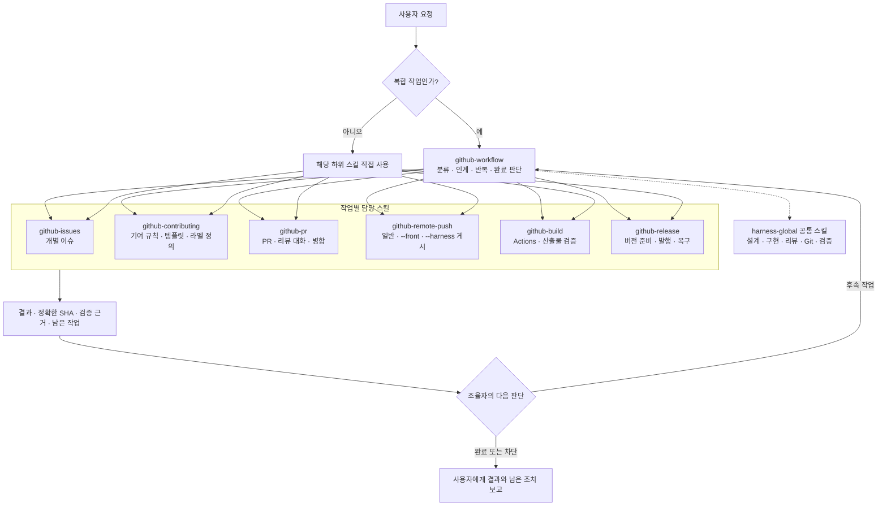
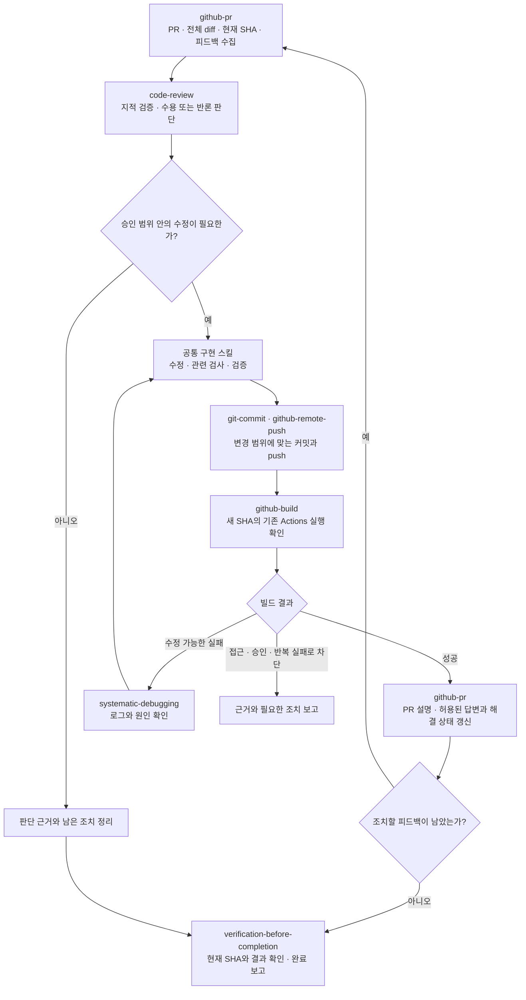
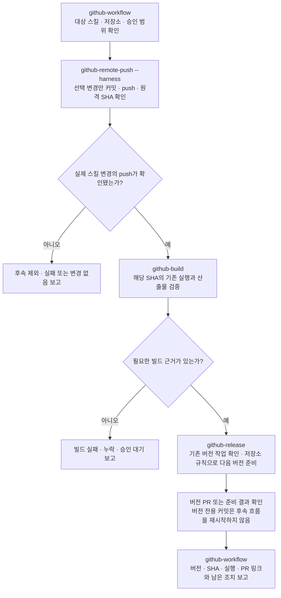

# Harness GitHub

GitHub 저장소 작업을 위한 Codex 스킬입니다. 복합 작업은 `github-workflow`로 시작하고, 단일 작업은 해당 하위 스킬을 직접 사용합니다.

| 스킬 | 범위 |
| --- | --- |
| [github-workflow](github-workflow/SKILL.md) | 요청 분류, 작업 간 인계, 반복과 완료 판단 |
| [github-issues](github-issues/SKILL.md) | 개별 이슈 조회·작성·수정·분류 |
| [github-contributing](github-contributing/SKILL.md) | 기여 문서·이슈 폼·PR 템플릿·라벨 정의 |
| [github-pr](github-pr/SKILL.md) | PR 작성·수정, 리뷰 대화와 병합 상태 |
| [github-remote-push](github-remote-push/SKILL.md) | 프로젝트 및 선택 스킬 게시 |
| [github-build](github-build/SKILL.md) | GitHub Actions 빌드 설정·운영·산출물 검증 |
| [github-release](github-release/SKILL.md) | 버전 준비·릴리스 설정·발행·복구 |

각 스킬 폴더를 사용자 스킬 디렉터리에 설치합니다. 공통 리뷰와 구현·Git 도구는 [harness-global](https://github.com/harness-subdev/harness-global)의 `code-review`, `git-commit`, `systematic-debugging`, `test-driven-development`, `brainstorming`, `writing-plans`, `implement`, `subagent-driven-development`, `using-git-worktrees`, `resolving-merge-conflicts`, `verification-before-completion`을 재사용합니다. 스킬의 상대 경로는 설치 후 같은 스킬 루트에 배치된 공통 스킬을 가리킵니다.

- 일반 프로젝트 push: `github-remote-push`
- UI34521 프로젝트 게시: `github-remote-push --front`
- harness 스킬 게시와 기존 빌드/버전 후속: `github-workflow`에서 `--harness` 요청

## 오케스트레이션 구조

`github-workflow`는 요청을 분류하고 다음 작업의 담당 스킬을 선택하는 조율자입니다. 하위 스킬은 한 작업의 결과와 근거를 반환하고, 조율자가 다음 작업·반복·완료 여부를 결정합니다. 단일 작업은 하위 스킬로 바로 시작할 수 있습니다. 아래 화살표는 스킬 간 책임 인계를 나타내며, 별도 상주 서비스나 자동 실행 엔진을 뜻하지 않습니다.



인계에는 작업 범위, 저장소·브랜치·정확한 리비전, 기존 승인 범위, 근거와 기대 결과를 함께 전달합니다. 공통 구현은 `brainstorming` → `writing-plans` → `implement` 또는 `subagent-driven-development`를 재사용하고, 최종 완료 판단은 `verification-before-completion`의 검증 근거를 따릅니다.

## 오케스트레이션 워크플로우

### PR 피드백과 수정 반복

다음은 PR 피드백 수집부터 수정·빌드 확인까지의 대표 흐름입니다. `github-pr`은 원격 대화를 관리하고, 실제 수정 필요성 판단은 공통 `code-review`가 맡습니다. 각 단계 사이의 다음 담당자 선택은 `github-workflow`가 수행합니다.



새 커밋이 생기면 이전 SHA의 빌드·리뷰 근거를 그대로 사용하지 않습니다. 같은 실패가 근거 있는 두 차례 수정에도 반복되거나 필요한 승인·접근이 없으면 중단하고 남은 조치를 보고합니다. PR 답변·스레드 해결·병합은 각각 허용된 범위에서 수행하며, 빌드 성공만으로 병합을 승인한 것으로 보지 않습니다.

### harness 스킬 게시 후 빌드·버전 준비

`--harness`의 후속 흐름은 실제 스킬 변경을 push하고 원격 SHA까지 확인한 저장소별로 한 번씩 이어집니다. 변경 없는 저장소나 로컬에만 남은 변경, 실패하거나 확인되지 않은 push는 제외합니다.



저장소에 빌드·버전 인프라나 증가 규칙이 없으면 임의로 추가하거나 버전을 정하지 않습니다. 버전 준비와 공개 릴리스 발행은 별도 작업입니다. 이 저장소는 아래 운영 규칙에 따라 `VERSION`·`CHANGELOG.md`를 PR로 준비하고, 승인된 버전 태그 push에서만 릴리스를 게시합니다.

## 통합된 이전 스킬

`front-reference-push`, 잘못 변경된 중복 이름 `web-reference-publish`, `my-herness-skills-push`는 `github-remote-push`로 통합했습니다. `devops-build-version-setup`과 `devops-build-release-manage`는 빌드/릴리스 책임에 따라 `github-build`와 `github-release`로 재편했습니다. 이전 저장소의 해당 복사본을 중복 설치하지 않습니다.

공통 `requesting-code-review`와 `receiving-code-review`는 harness-global의 `code-review` 요청/피드백 모드로 통합했습니다. 현재 분류와 저장소 매핑은 [공통 스킬 정책](github-remote-push/references/skill-policy.md), 채택 출처는 [출처 및 이관 기록](github-workflow/references/source-adoption.md)을 확인하세요.

## 빌드와 버전 관리

`VERSION`이 저장소 전체의 단일 버전이며 현재 버전은 `0.1.1`입니다. Git과 Node.js 24 환경에서 다음 명령을 사용합니다.

```sh
node --test scripts/*.test.mjs
bash scripts/build.sh
```

빌드는 커밋된 소스를 검사하고 `dist/`에 버전·SHA가 포함된 소스 패키지와 SHA-256 체크섬을 만듭니다. 패키지에는 스킬 리소스, 버전별 변경 내역과 run/attempt 출처가 포함됩니다.

PR·main push·수동 실행은 빌드만 수행합니다. 다음 버전은 `VERSION`과 `CHANGELOG.md`를 수정한 PR로 준비하며, 일치하는 `v*` 태그 push에서만 릴리스를 게시합니다. [빌드·버전·릴리스 운영 안내](docs/RELEASING.md)를 참고하세요.
